# Azure Hybrid Identity & SecOps Lab

Jonathan Tapia · AZ-104 · CompTIA A+ / Network+ / Security+

My [first Azure lab](https://github.com/jontapia/jontapia-az104-lab) covered the basics. Before starting AZ-500, my next cert, I wanted to see if I had the concept of building a secure environment or at least an environment that has secure features: So this labs covers what it looks like when an attack hits a users account/identity, and how to resolve that incident properly.
So this lab runs an Active Directory domain in Azure with no public IPs on any server, sends the Windows Security logs to Microsoft Sentinel, and has detection rules for brute force, lockouts and privilege escalation. Then I attack my own test account, watch the incident open in Sentinel, and fix it with a Tier 1 account that can only unlock and reset users, I learned a lot during this lab and it help me solidify my understanding with Azure better

## Architecture

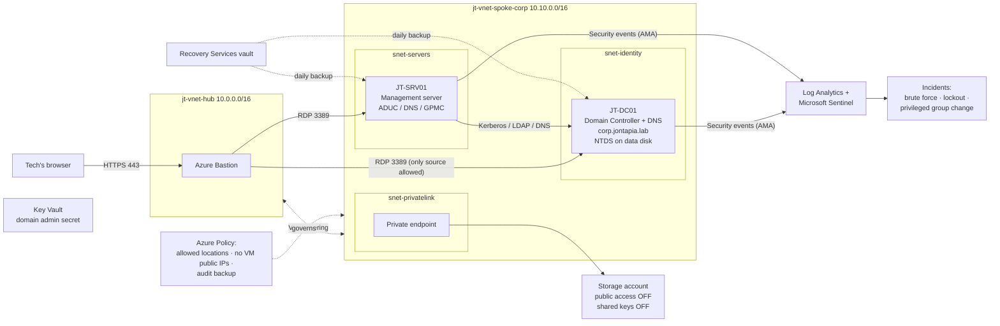

## What gets deployed

| Layer | What | Detail |
|---|---|---|
| **Network** | Hub-spoke VNets + peering | Bastion in the hub; identity, server and private-link subnets in the spoke |
| | NSG | RDP allowed **only** from the Bastion subnet; lateral RDP and internet inbound denied |
| | Azure Bastion (Basic) | The only way in. No VM has a public IP |
| **Identity** | AD DS forest `corp.jontapia.lab` | DC promoted by Run Command; NTDS/SYSVOL on a data disk with host caching off |
| | OU design | `_JT-Lab` → Users, Helpdesk, Admins, Groups, Servers, Workstations; new computers redirected to Workstations |
| | Users & groups | Tier 1 tech `jontapia.t1`, four end users across Finance and Sales, department security groups |
| | **Delegation** | `GG-Helpdesk-Tier1` can reset passwords and unlock accounts **only** in the Users OU. Not Admins, not Helpdesk |
| | Password policy | 12+ characters, complexity on, lockout after 5 bad attempts for 15 minutes |
| **Secrets** | Key Vault (RBAC mode) | Domain admin password is generated at deploy time, never typed, and stored only here |
| **Data** | Storage + private endpoint | Reachable only from inside the VNet through `privatelink.blob` DNS; Entra ID auth only |
| **Governance** | Azure Policy | Deny resources outside East US; deny public IPs on NICs; audit VMs without backup |
| **Resilience** | Recovery Services vault | Both servers backed up daily at 6 PM ET with 7-day retention |
| **Detection** | Microsoft Sentinel | Collects Security events 4624/4625/4720/4724/4728/4732/4740/4756/4767 |
| | Analytics rules | Brute force (5+ failures in 10 min) · account lockout · member added to a privileged group |
| | Azure Monitor | Email alert whenever an NSG rule is changed |
| **Cost** | Auto-shutdown | Both VMs shut down at 7 PM ET |

## Why I built it this way

- **No public IPs on servers, enforced by policy as well as design.** Bastion is the only entry point, and the NSG only accepts RDP from the Bastion subnet. Even an Owner who tries to attach a public IP to a NIC gets denied by Azure Policy, this helps secure the servers and makes sure that no malicious actor can get it and also if a account with elevated permission were to get compromised then they still wouldn't be able to do all actions.
- **Tiered admin accounts.** Daily help desk work happens as `jontapia.t1`, which can reset and unlock accounts and nothing else which is what permission would look like in real world, although with some other low level permission added to it. Domain admin is a separate account whose password lives only in Key Vault which is best practice for Azure.
- **Delegation through ACLs, not group nesting.** Tier 1 gets `Reset Password` plus `lockoutTime`/`pwdLastSet` write rights on one OU, applied with `dsacls`. They're **not** in Account Operators, which would be far too broad.
- **Detection before resolution.** The lockout policy and the Sentinel rules are designed together. Five bad passwords lock the account and open a Sentinel incident, so the tech has evidence before unlocking anything which will notify me, so this is really useful to see if there is anything going on in with your servers/domain and can possibly catch bad actors before they get even more access.
- **The DC is built for Azure.** Static private IP, AD database on a data disk with caching set to None, and the VNet's DNS pointing at the DC. The DC forwards to Azure DNS (168.63.129.16) so private endpoint names resolve to private IPs.
- **Storage with no public surface.** Public network access is off and shared-key auth is off, so even a leaked key wouldn't work, which is important for obvious reasons but also can help with compliaance if your company demands it.

### Where I cut corners for the lab

| Lab | Production |
|---|---|
| Backup vault soft delete **off** so teardown works same day | Soft delete **on**, plus immutability. Ransomware targets backups first |
| Single DC | Two or more DCs in an availability zone or set |
| Azure DNS as secondary DNS in the spoke (needed while the DC builds) | DCs only |
| Key Vault public endpoint, RBAC-protected | Key Vault private endpoint |
| Bastion Basic | Bastion Standard with session recording / native client |

## Build log (November 15, 2026)

- **Region / size:** West US 2 on `Standard_B2als_v2`. `Standard_B1ms` failed with `SkuNotAvailable`. My free trial couldn't use East US at all.
- **Deploy failure 1:** the Sentinel analytics rules and the data collection rule failed because the `SecurityEvent` table didn't exist yet. Fixed by installing the SecurityInsights solution first, plus a retry.
- **Deploy failure 2:** after I cancelled a run, Azure kept building the network in the background, and the next run failed with `DeploymentActive`. I had to wait for the first deployment to finish before redeploying.
- **Bastion sign-in:** `JONTAPIA\jontapia` failed. The UPN format `jontapia@corp.jontapia.lab` worked.
- **First login mistake:** I signed in with the local `jontapia` account, and ADUC refused to open. Signing in with the domain account fixed it.
- **Detection time:** failed logons started at 9:50 PM; Sentinel created the incident at 9:57 PM, about **7 minutes**.
- **Unexpected:** the Sentinel incident opened in the **Microsoft Defender portal**, not just the Azure portal, which is what Azure wants from now on.
- **Unexpected #2:** I set backup soft delete to *Disabled* in the template, but teardown still triggered a "Delete Backup data" alert saying the data would be kept for 14 days (screenshot 10). The soft delete setting I deployed didn't take effect the way I expected. Which is something im currently studying to understand better because that really caught me up for a second.

## Proof it ran

| | |
|---|---|
| 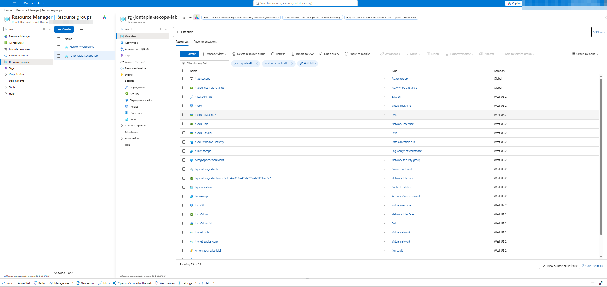 | 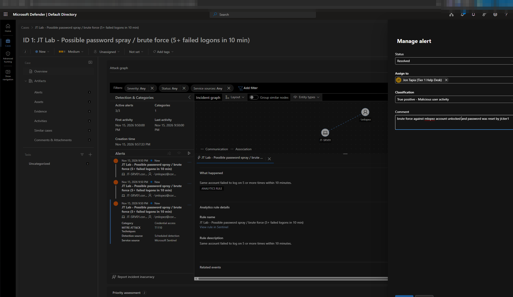 |
| 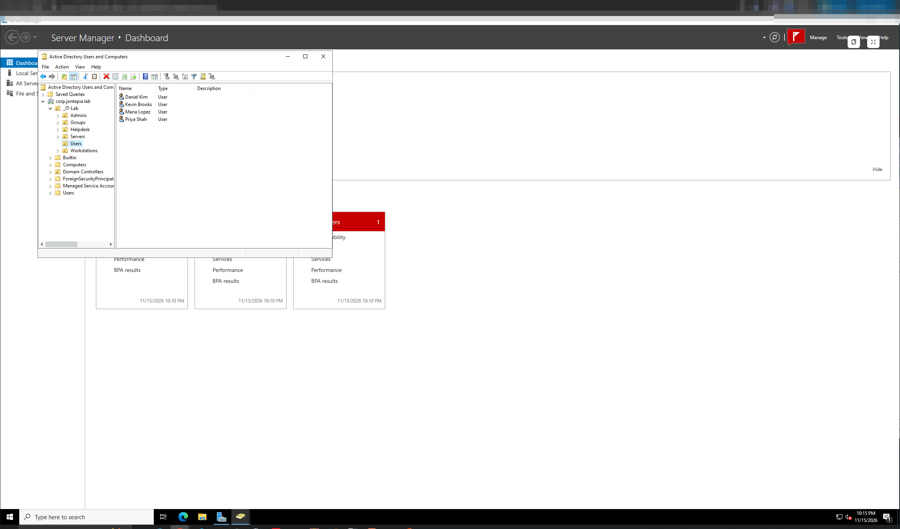 | 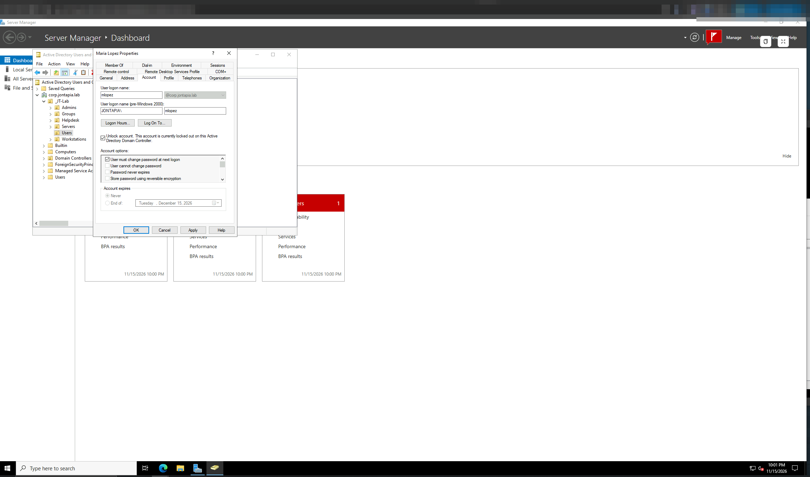 |
| 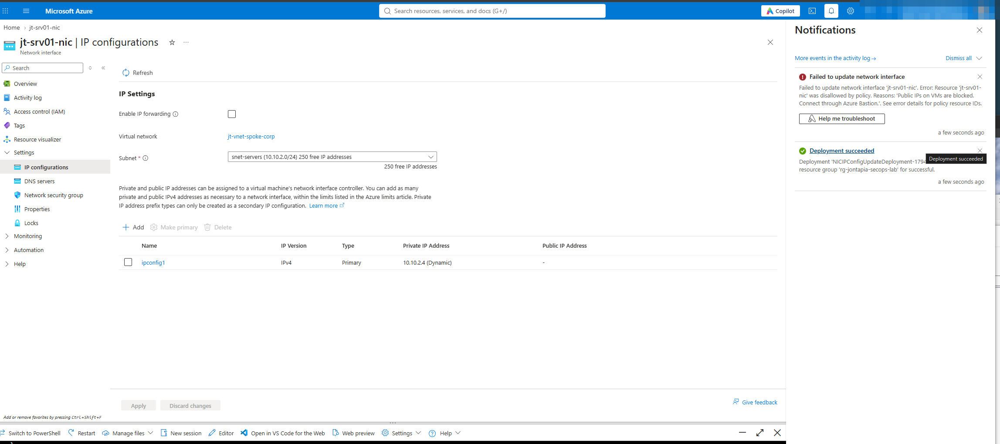 | 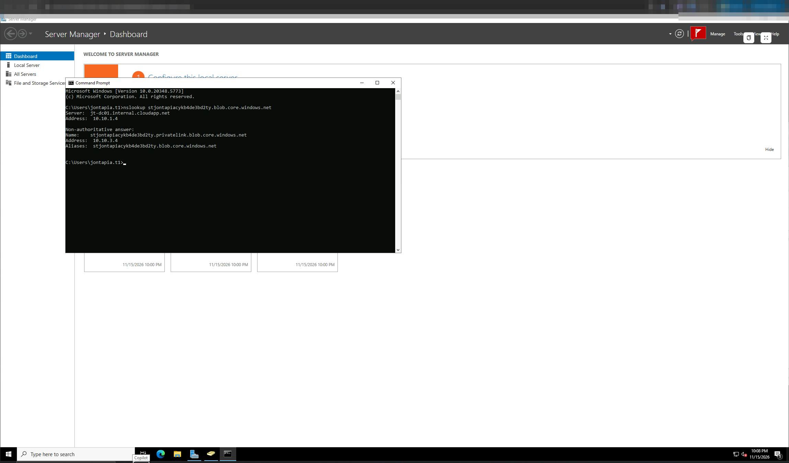 |
| 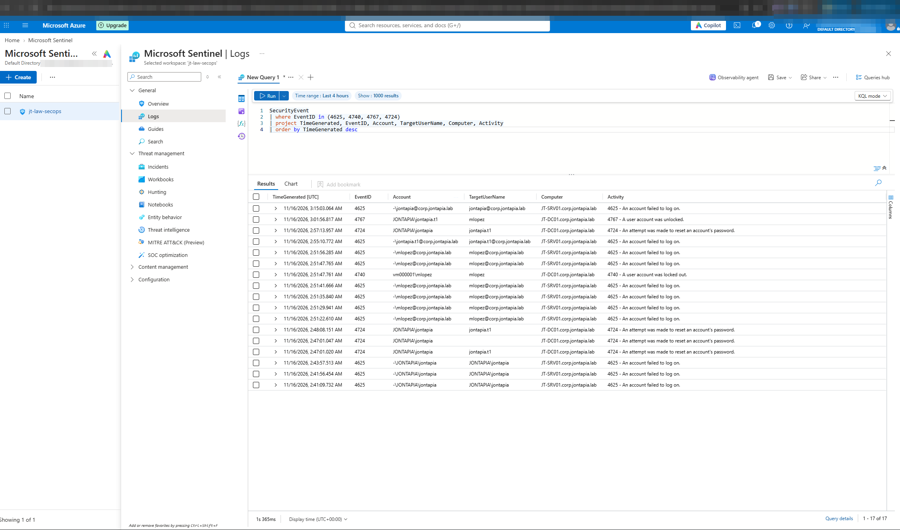 | 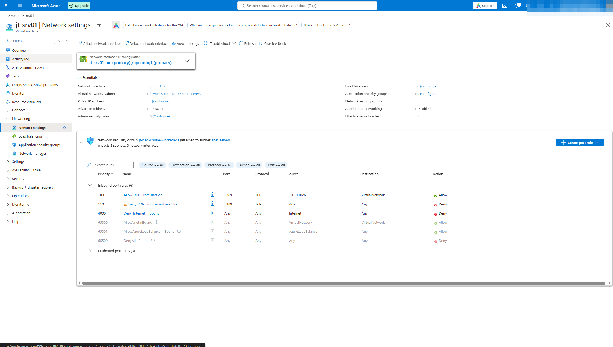 |
| 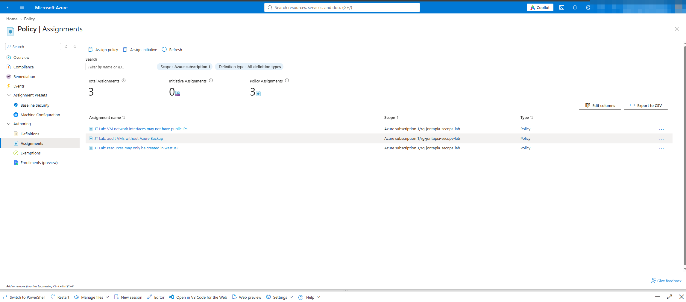 | 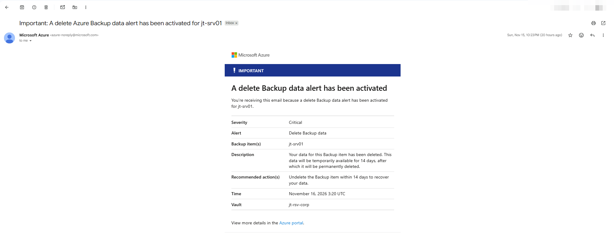 |

## What happened during the walkthrough

| Time (ET) | Event | Evidence |
|---|---|---|
| 9:41–9:44 PM | 3 failed logons for `JONTAPIA\jontapia` (the Bastion username format issue) | 4625 events, screenshot 7 |
| 9:47–9:48 PM | As domain admin, reset `jontapia.t1`'s password to provision the Tier 1 account | 4724 events |
| 9:51 PM | 6 bad passwords as `mlopez` → account locked | 4625 ×6, 4740 |
| 9:57 PM | Sentinel opened a **brute force** incident (T1110) and a **lockout** incident | Screenshot 2 |
| 10:01 PM | Signed in as `jontapia.t1` and **unlocked** `mlopez` | 4767, screenshot 4 |
| — | Resolved the incident as **True positive**, assigned to the Tier 1 account | Screenshot 2 |

<!-- If you also reset mlopez's password as jontapia.t1, add a 4724 row for it. Right now the logs only show the unlock by jontapia.t1. -->

## Incident → ticket walkthrough

1. **Provision the tech.** Get the admin password from Key Vault (the command prints at the end of the deploy). Bastion into `JT-SRV01` as `JONTAPIA\jontapia`, open ADUC, and reset `jontapia.t1`'s password. Untick *User must change password at next logon*, because Bastion's NLA sign-in can't handle a forced change. *That's admin provisioning.* `GG-Helpdesk-Tier1` is already in JT-SRV01's local Remote Desktop Users group.
2. **Attack.** From the Bastion login screen, sign in to `JT-SRV01` as `JONTAPIA\mlopez` with a wrong password 6 times.
3. **Detect.** Within about 10 minutes Sentinel opens **two incidents**: brute force on `mlopez` and the lockout. Investigate the entities and timeline.
4. **Resolve as Tier 1.** Sign in as `JONTAPIA\jontapia.t1`, then unlock `mlopez` and reset her password in ADUC. Confirm the **4767** (unlock) and **4724** (reset) events arrive in Sentinel. Then close the incident with notes.
5. **Prove least privilege.** As `jontapia.t1`, try to reset the password of a user in the Admins or Helpdesk OU. It's denied.
6. **Privilege escalation drill.** As domain admin, add `kbrooks` to Domain Admins. A **High** severity incident fires. Remove him and document it.
7. **Private endpoint check.** On `JT-SRV01`, run `nslookup <storageaccount>.blob.core.windows.net`. It returns a `10.10.3.x` address. From your home PC the same name resolves publicly and access is refused.
8. **Policy check.** In the portal, try to attach a public IP to `jt-srv01-nic`. The request is denied by policy `JT Lab: VM network interfaces may not have public IPs`.
9. **Restore drill.** Run an on-demand backup of `JT-SRV01`, delete a file, and recover it with **File Recovery**.

